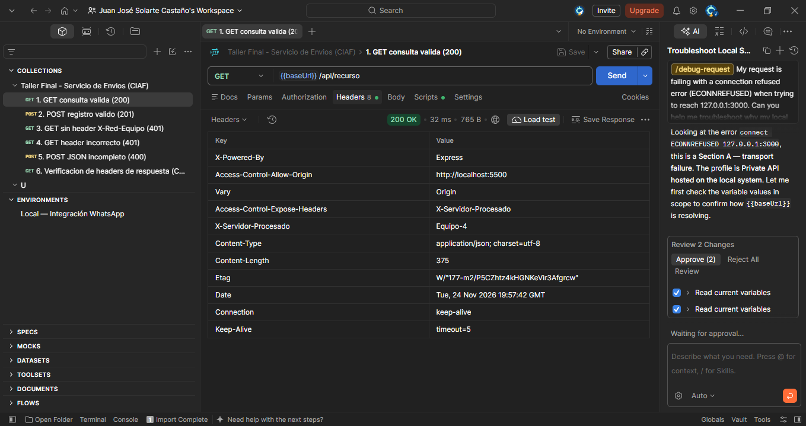
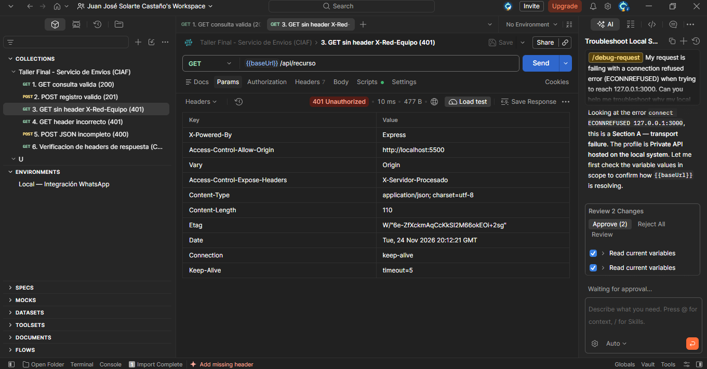
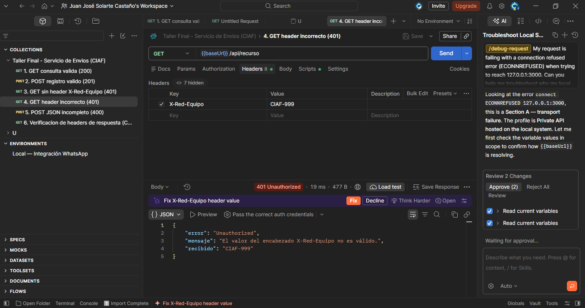

# Taller Final – Programación de Redes (CIAF)
## Servicio web de consulta y registro de estado de envíos

> **Tema:** Protocolo HTTP, Encabezados (Headers), Políticas CORS y Seguridad en la Comunicación
> **Tecnologías:** Node.js · Express · cors · Postman

---

## 1. Integrantes del equipo

Ordenados alfabéticamente por apellido según el listado oficial de asistencia.

| # Lista oficial | Nombre completo |
|---|---|
| 4 | Correa Osorio Juan David |
| 17 | Montañez Gatell Anthony Joel |
| 25 | Solarte Castaño Juan Jose |
| 27 | Valencia Quintero Andres Felipe |

Grupo 1 – miércoles.

- **Valor de N:** `N = 4` (número de lista de Correa Osorio Juan David, primer integrante en orden alfabético)
- **Encabezado de petición asignado:** `X-Red-Equipo: CIAF-4`
- **Encabezado de respuesta:** `X-Servidor-Procesado: Equipo-4`

---

## 2. Escenario de red

Una empresa de mensajería con sede en Pereira necesita que sus clientes y sucursales consulten el **estado de un envío** a partir de su número de guía y que las sucursales puedan **registrar envíos nuevos**.

**¿Qué cliente consume el servicio?**
- **Navegador web:** el portal de rastreo que usan los clientes finales (simulado en `cliente/index.html`, servido en `http://localhost:5500`). Por ser un navegador, aquí es donde aplica CORS.
- **App móvil de los mensajeros** y **servidores de sucursales** también podrían consumir la API (a estos clientes no los restringe CORS, sino la validación del header).

**Riesgos si el servicio viajara por HTTP sin cifrar:**
- **Espionaje (sniffing):** cualquiera en la misma red Wi‑Fi o un proveedor intermedio podría leer las direcciones, ciudades y nombres de los destinatarios (datos personales protegidos por la Ley 1581 de 2012).
- **Robo de la credencial:** el header `X-Red-Equipo` viaja en texto plano; quien lo capture podría hacerse pasar por una sucursal y registrar envíos falsos.
- **Modificación en tránsito (Man‑in‑the‑Middle):** un atacante podría cambiar el estado de un envío ("Entregado" en vez de "En tránsito") o cambiar el destino en un POST.
- **Suplantación del servidor:** sin certificado, el cliente no puede verificar que está hablando con el servidor real de la empresa.

---

## 3. Instalación y ejecución

```bash
npm install
npm start
# Servidor en http://localhost:3000
```

El servidor ya está configurado con `N = 4`. Si se necesitara otro valor, se puede cambiar la constante `N` en `server.js` o ejecutar:

```bash
# Linux / Mac
EQUIPO_N=12 npm start
# Windows PowerShell
$env:EQUIPO_N=12; npm start
```

### Endpoints

| Método | Ruta | Descripción | Respuestas |
|---|---|---|---|
| GET | `/api/recurso` | Lista todos los envíos | 200, 401 |
| GET | `/api/recurso?guia=ENV-1001` | Consulta un envío por guía | 200, 404, 401 |
| POST | `/api/recurso` | Registra un envío (JSON: `{"origen":"Pereira","destino":"Manizales"}`) | 201, 400, 401 |

Todas las rutas exigen el encabezado `X-Red-Equipo: CIAF-N`.

---

## 4. Configuración de CORS

```js
app.use(cors({
  origin: 'http://localhost:5500',
  methods: ['GET', 'POST'],
  allowedHeaders: ['Content-Type', 'X-Red-Equipo'],
  exposedHeaders: ['X-Servidor-Procesado']
}));
```

Encabezados que devuelve el servidor:

| Encabezado | Valor | Para qué sirve |
|---|---|---|
| `Access-Control-Allow-Origin` | `http://localhost:5500` | Le dice al navegador cuál es el único origen que puede leer la respuesta |
| `Access-Control-Allow-Methods` | `GET,POST` | Métodos permitidos (en la respuesta preflight `OPTIONS`) |
| `Access-Control-Allow-Headers` | `Content-Type,X-Red-Equipo` | Headers que el navegador puede enviar (en la respuesta preflight) |
| `Access-Control-Expose-Headers` | `X-Servidor-Procesado` | Permite que el JavaScript del navegador lea nuestro header personalizado |
| `Vary` | `Origin` | Indica a las cachés que la respuesta depende del origen |

Como el cliente envía un header personalizado (`X-Red-Equipo`), el navegador primero hace una petición **preflight** `OPTIONS`; el servidor responde `204 No Content` con los headers anteriores y solo entonces el navegador envía el GET/POST real.

---

## 5. Validación del encabezado parametrizado (middleware)

```js
function validarEquipo(req, res, next) {
  const valor = req.headers['x-red-equipo'];
  if (!valor)                 return res.status(401).json({ error: 'Unauthorized', mensaje: 'Falta el encabezado obligatorio X-Red-Equipo...' });
  if (valor !== `CIAF-${N}`) return res.status(401).json({ error: 'Unauthorized', mensaje: 'El valor del encabezado X-Red-Equipo no es válido.' });
  res.set('X-Servidor-Procesado', `Equipo-${N}`);
  next();
}
app.use('/api', validarEquipo);
```

- Si el header falta o no coincide **exactamente**, responde `401 Unauthorized` con un JSON explicativo.
- Si es correcto, agrega `X-Servidor-Procesado: Equipo-N` y deja pasar la petición al endpoint.
- La respuesta 401 no revela el valor correcto, para no regalar la credencial.

---

## 6. Colección de Postman

Archivo: **`Taller-Final-Envios.postman_collection.json`** (Postman → Import). La colección usa dos variables: `baseUrl` (`http://localhost:3000`) y `N` (ya configurada en `4`).

| # | Petición | Esperado |
|---|---|---|
| 1 | GET consulta válida | **200** + `X-Servidor-Procesado` |
| 2 | POST registro válido | **201** |
| 3 | GET sin header `X-Red-Equipo` | **401** |
| 4 | GET con header incorrecto (`CIAF-999`) | **401** |
| 5 | POST con JSON incompleto | **400** |
| 6 | Verificación de headers de respuesta (envía `Origin: http://localhost:5500`) | Comprueba `Access-Control-Allow-Origin`, `X-Servidor-Procesado` y `Content-Type` |

Cada petición tiene **tests** automáticos (pestaña *Tests / Scripts*), así que se puede ejecutar todo con el *Collection Runner*.

---

## 7. Análisis teórico aplicado

### 7.1 Viaje de la petición en el modelo TCP/IP

Ejemplo: Postman envía `GET http://localhost:3000/api/recurso` con `X-Red-Equipo: CIAF-N`.

| Capa TCP/IP | Equivalente OSI | Qué pasa en nuestro caso | Unidad de datos |
|---|---|---|---|
| **4. Aplicación** | 7, 6, 5 | Postman arma el mensaje HTTP/1.1: línea de petición (`GET /api/recurso HTTP/1.1`), headers (`Host`, `X-Red-Equipo`, `Content-Type`) y cuerpo JSON en el POST. En el otro extremo Express lee los headers, el middleware valida `X-Red-Equipo` y arma la respuesta con código de estado y headers. Si fuera HTTPS, TLS cifraría aquí el mensaje. | Mensaje HTTP |
| **3. Transporte** | 4 | El sistema operativo abre una conexión **TCP** (saludo de tres vías SYN, SYN‑ACK, ACK) desde un puerto efímero del cliente (ej. 52341) al **puerto 3000** donde escucha Express. TCP divide el mensaje en segmentos, los numera, confirma su recepción (ACK) y los retransmite si se pierden. | Segmento |
| **2. Internet** | 3 | **IP** encapsula cada segmento en un paquete con IP origen y destino. Como es `localhost`, ambas son `127.0.0.1` (en un despliegue real serían la IP del cliente y la del servidor, y los routers decidirían la ruta). | Paquete / datagrama |
| **1. Acceso a red** | 2, 1 | En localhost el paquete pasa por la **interfaz loopback** y nunca sale a un cable. En una red real se encapsula en una trama Ethernet o Wi‑Fi con direcciones **MAC** (resueltas con ARP) y viaja como bits por el medio físico. | Trama / bits |

Del lado del servidor el proceso se invierte (**desencapsulación**): la trama sube a paquete, el paquete a segmento, TCP reensambla el mensaje y lo entrega al proceso Node.js que escucha en el puerto 3000, y Express lo procesa. La respuesta (`200`/`401` + headers) recorre el mismo camino de regreso.

### 7.2 ¿Qué protege SSL/TLS (HTTPS)?

TLS funciona entre la capa de aplicación y la de transporte: cifra el mensaje HTTP **antes** de entregarlo a TCP. En nuestro servicio protege:

- **Confidencialidad:** la URL, los headers (incluido `X-Red-Equipo`, que es nuestra credencial) y el JSON con los datos del envío viajan cifrados. Quien intercepte el tráfico solo ve bytes ilegibles, la IP y el puerto de destino.
- **Integridad:** cada registro TLS lleva un código de autenticación (MAC/AEAD); si alguien cambia un byte en el camino (por ejemplo el `destino` de un POST), la conexión lo detecta y lo rechaza.
- **Autenticación del servidor:** el certificado digital, firmado por una autoridad certificadora, demuestra que el cliente habla con el servidor real de la empresa de envíos y no con un impostor.

Durante el **handshake TLS** cliente y servidor negocian la versión y el cifrado, el servidor envía su certificado y ambos acuerdan una clave de sesión simétrica (por ejemplo con ECDHE) que luego usan para cifrar todo el tráfico.

**Lo que TLS no hace:** no decide *quién* puede usar la API. Esa es la función de nuestro header `X-Red-Equipo`. TLS solo impide que esa credencial sea robada en el camino. Por eso las dos medidas se complementan.

### 7.3 ¿Qué problema resuelve CORS?

Los navegadores aplican la **Política del Mismo Origen (Same‑Origin Policy)**: un script cargado desde un origen (protocolo + dominio + puerto) no puede leer respuestas de otro origen. Nuestro portal corre en `http://localhost:5500` y la API en `http://localhost:3000`; como el puerto es distinto, son **orígenes diferentes**.

**CORS** es el mecanismo con el que el servidor le dice al navegador, mediante headers, qué orígenes externos sí están autorizados. En nuestro caso:

- Si el portal de `http://localhost:5500` consulta la API, el servidor responde `Access-Control-Allow-Origin: http://localhost:5500` y el navegador entrega los datos al script.
- Si una página maliciosa (por ejemplo `http://sitio-falso.com`) intenta leer los envíos desde el navegador de una víctima, el servidor no la autoriza y el **navegador bloquea** la lectura de la respuesta.

Importante para la sustentación: **CORS lo aplica el navegador, no el servidor.** Postman, `curl` o una app móvil no aplican CORS, por eso en Postman la petición funciona aunque no se envíe el header `Origin`. CORS protege a los usuarios del navegador; no es un mecanismo de autenticación. Por eso además usamos la validación de `X-Red-Equipo`.

---

## 8. Evidencias (capturas de Postman)

**Respuesta exitosa (200) con Headers de respuesta visibles** (`X-Servidor-Procesado`, `Access-Control-Allow-Origin`):



**Respuesta 401 al omitir el encabezado `X-Red-Equipo`:**



Obsérvese que en la respuesta 401 **no** aparece `X-Servidor-Procesado`, porque ese encabezado solo se agrega en las respuestas exitosas.

**Respuesta 401 con valor incorrecto (`X-Red-Equipo: CIAF-999`):**



---

## 9. Estructura del repositorio

```
├── server.js                                  # Servidor Express (CORS + middleware + endpoints)
├── package.json
├── .gitignore                                 # excluye node_modules
├── Taller-Final-Envios.postman_collection.json
├── cliente/index.html                         # Cliente web para demostrar CORS (puerto 5500)
├── capturas/                                  # Capturas de Postman
└── README.md
```
